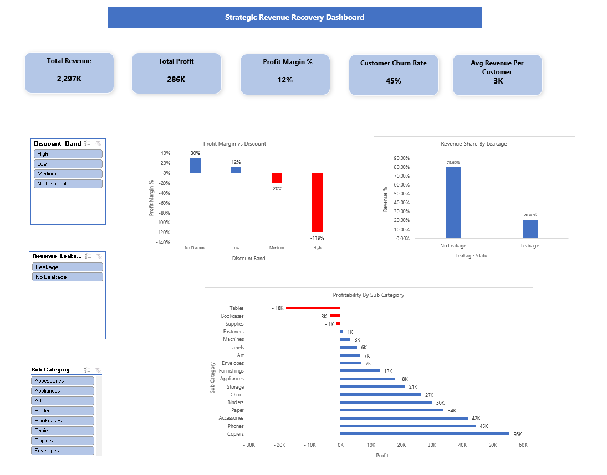
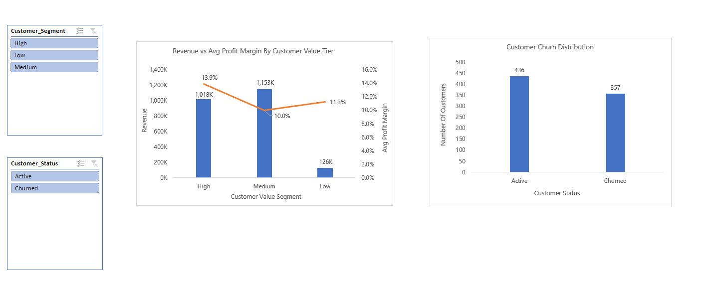
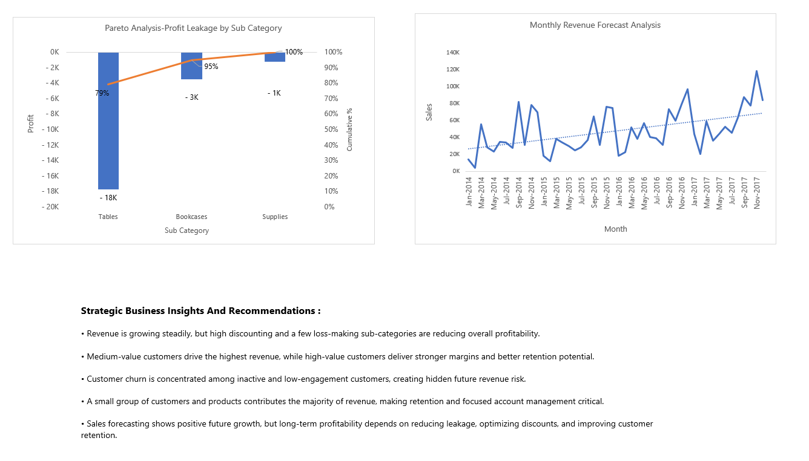

# Strategic Revenue Recovery: Root Cause Analysis of Customer Churn and Revenue Leakage

## Project Overview

* This project focuses on identifying revenue leakage, understanding customer churn, and improving overall profitability using Excel-based business analysis.
* The goal was to move beyond basic reporting and understand where profit is being lost, which customers create the most value, and what actions can help improve long-term business performance.
* The project was built using feature engineering, customer segmentation, churn analysis, profitability analysis, Pareto analysis, a monthly sales trend, and an interactive dashboard.

## Business Objective

To identify revenue leakage, reduce customer churn, and improve profitability by analyzing discount impact, customer value, product performance, and long-term revenue trends.

## Dataset

- Superstore sales dataset: 9,994 sales records, January 2014 to December 2017, US customers.
- 793 unique customers.
- Money values are assumed to be in USD ($), as the data is from the US.
- File in this repo: Super_store_sales_data.xlsx

## Definitions

- **Revenue leakage:** an order line (one product in an order) where profit is negative. These lines made up 20.4% of total revenue.
- **Discount bands:** No Discount (0%), Low (up to 20%), Medium (21% to 50%), High (above 50%).
- **Churned customer:** a customer who has not placed any order for more than 90 days. Days are counted up to the last date in the data (30 Dec 2017).
- **Customer value tiers:** customers grouped by their share of total revenue. High is 0.2% or more, Medium is 0.05% to under 0.2%, and Low is under 0.05%.

## Key KPIs Tracked

* Total Revenue
* Total Profit
* Profit Margin %
* Average Revenue Per Customer
* Customer Churn Rate

## Analysis Areas Covered

* Revenue Leakage Analysis
* Discount Impact on Profitability
* Customer Value Segmentation
* Customer Churn Analysis
* Sub-Category Profitability Analysis
* Pareto Analysis (80/20 Rule)
* Monthly Sales Trend Analysis

## Tools & Analytical Techniques Used

* Microsoft Excel
* Pivot Tables
* Pivot Charts
* Slicers
* Conditional Formatting
* Feature Engineering
* Customer Segmentation
* Churn Classification
* Pareto Analysis

## Dashboard Preview

### Executive Overview

### Customer Analysis

### Strategic Insights

## Key Business Insights

- **Higher discounts reduce profit.** Profit margin was +30% with no discount, +12% with Low discount, -20% with Medium and -119% with High discount.
- **20.4% of revenue came from loss-making order lines.**
- **Only 3 sub-categories lose money:** Tables (-$18K), Bookcases (-$3K) and Supplies (-$1K). Tables alone cause 79% of that loss.
- **Medium-tier customers bring the most revenue ($1.15M).** High-tier customers have the best average profit margin (13.9%).
- **357 of 793 customers (45%) are churned.**
- **Monthly sales trend upward from 2014 to 2017.**

## Recommendations

- Reduce discounts in the Medium and High bands.
- Review pricing and discounts for Tables, Bookcases and Supplies.
- Focus retention efforts on churned and at-risk customers, especially high-value ones.
- Encourage Medium-tier customers to buy more, since they bring the most revenue but have a lower margin than High-tier customers.
## Expected Business Outcome

Improve overall profitability by controlling discount leakage, reducing churn, and focusing on high-value customers and profitable product categories. This helps protect revenue, improve margins, and support long-term business growth.

This project was created as part of my data analytics portfolio to demonstrate business problem-solving, dashboard storytelling, and decision-focused analysis using Excel.

